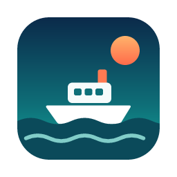
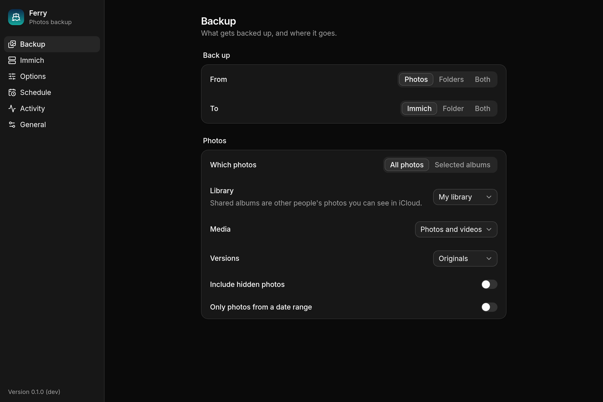

  

<h1 align="center">Ferry</h1>

  Back up Apple Photos to <a href="https://immich.app">Immich</a> and/or a folder, from the macOS menu bar.

  

  

Ferry lives in the menu bar and backs up your Photos library (and any folders you pick) to an
Immich server, to a folder organised by date, or both. Each backup only adds what's missing:
anything already on the server, whether Ferry, the Immich phone app or anything else put it
there, is recognised by its checksum and never uploaded twice.

It's a Rust and Tauri rewrite of [ImmiBridge](https://github.com/emerysilb/immibridge) by Emery
Silberman: a ~10 MB app instead of a SwiftUI one, and compatible with everything ImmiBridge
already backed up.

## Features

- **Photos and folders** to **Immich, a folder, or both**
- **Never re-uploads**: SHA-1 checks against the server, and fingerprints remembered between
  runs so later backups read only new or edited photos from Photos
- **Never deletes from Immich**. The one opt-in exception, replacing photos you edited since they
  were uploaded (Immich v2), uploads the new version before trashing the old one
- **Backup modes**: Smart incremental, Full, and Mirror (moves what you deleted from Photos out of
  the backup folder, into the Trash; never touches Immich)
- **Albums, favourites, locations and keywords** kept in step with Immich
- Live Photos, edited versions, hidden photos, date ranges and selected albums
- iCloud originals downloaded as needed, with progress
- **Pause and resume**, even across restarts; dry runs
- **Schedules** (every few hours, or daily at a time) with catch-up after sleep
- Light and dark themes, notifications, and self-updates

## Install

1. Download `Ferry-<version>.zip` from the [latest release](../../releases/latest),
   unzip it and move **Ferry.app** to Applications. Builds are for Apple silicon.
2. Builds aren't notarized: the first time, right-click Ferry.app → **Open**.
3. Click the ferry in the menu bar → **Open Settings**: choose what to back up and where, and enter
   your Immich server address and an API key (Immich → Account Settings → API Keys).

Ferry updates itself: **Settings → General → Check now**.

### Coming from ImmiBridge

**Settings → General → Import…** brings over your choices, schedule and ImmiBridge's Immich device
id, so earlier uploads are recognised. macOS protects other apps' data: if the import says so,
give Ferry Full Disk Access for the import (there's a button) and turn it off afterwards. The API
key has to be entered again, because ImmiBridge kept it in the Keychain.

## Permissions

- **Photos**: to read your library.
- **Local Network**: if your Immich server is on your network.
- **Automation (Photos)**: only for keywords. Apple offers no other way to read them, so Ferry
  starts Photos hidden and quits it again. Turn off **Immich → Keywords as tags** and Photos is
  never opened.

To change a permission later: System Settings → Privacy & Security.

## Immich versions

Ferry works with Immich v2 and v3. Every release is tested against real Immich servers, currently
v2.5.6 through v3.3.3, and every Sunday a job tests any new Immich release, fixes Ferry if it
broke, and ships the fix.

## Source code

Ferry is closed source for now, while it's being tested on real libraries. Once it's ready for a
public release, the source will be published here and this repository will become Ferry's home,
code and releases together. Until then this repository holds the builds, the update feed, and
issues: if something goes wrong, [open an issue](../../issues).

## License

Ferry builds on [ImmiBridge](https://github.com/emerysilb/immibridge), © 2025 Emery Silberman,
used under the MIT License: see [LICENSE-ImmiBridge](LICENSE-ImmiBridge). Ferry's own license
will come with its source.
